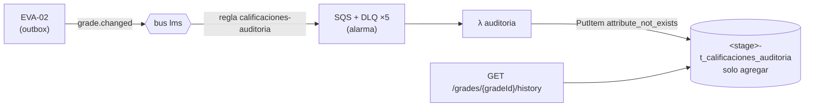

# nubeduca-ms-calificaciones

Microservicio de Nubeduca: Libro de notas, publicación ordenada de notas por SNS FIFO y auditoría inmutable de cambios.

Contrato: [`apis/ms-calificaciones.openapi.yaml`](https://github.com/nubeduca/nubeduca-contratos/blob/main/apis/ms-calificaciones.openapi.yaml) y el [catálogo de eventos](https://github.com/nubeduca/nubeduca-contratos/blob/main/eventos/catalogo.yaml) de `nubeduca-contratos`. **No se publica un evento ni se expone una ruta que no esté ahí.**

## Tareas

| Tarea | Responsable | Listo cuando |
|---|---|---|
| [EVA-02 · Calificaciones básicas](https://github.com/nubeduca/nubeduca-backlog/issues/27) | Dev 4 @Edinson695, Dev 3 @btoroled | La nota publicada llega en orden a sus consumidores (SNS FIFO, grupo `tenant_id:course_id`) |
| [DAT-01 · Auditoría de notas](https://github.com/nubeduca/nubeduca-backlog/issues/12) | Dev 5 @AIexander-lx | Cada `grade.changed` queda registrado y no se puede editar |

**Estado:** 🟢 Base armada desde `nubeduca-plantilla-servicio` y DAT-01 implementada (probada en AWS). 🟡 EVA-02 (libro de notas, `grade.posted` por SNS FIFO, seed) por hacer sobre esta base.

## Eventos

| | |
|---|---|
| `source` | `lms.grading` |
| Publica | `lms.grading.grade.changed.v1`, `lms.grading.grade.posted.v1` (bus y SNS FIFO `nubeduca-<stage>-notas.fifo` → ms-notificaciones) |
| Consume | `lms.assessment.assignment.published.v1`, `lms.assessment.submission.graded.v1`, `lms.courses.enrollment.created.v1`, `lms.courses.enrollment.dropped.v1` |

## Auditoría de notas (DAT-01)



- **Cada `lms.grading.grade.changed.v1` queda registrado.** La Lambda `auditoria` valida el evento contra su esquema y lo guarda con `PutItem` condicional (`attribute_not_exists(sk)`). Si SQS lo entrega dos veces, el segundo intento no hace nada. A diferencia de un consumidor normal, **no descarta versiones viejas**: guarda todos los cambios, lleguen en el orden que lleguen. Un evento que no cumple el contrato se reintenta y termina en la DLQ, que tiene alarma, así que no se pierde en silencio.
- **No se puede editar.** La tabla tiene una política de recurso que **niega** `UpdateItem`, `DeleteItem`, `BatchWriteItem`, `PartiQLUpdate` y `PartiQLDelete` a cualquier principal, el LabRole incluido. Probado en AWS: las cinco operaciones dan `AccessDenied`. Además el código no tiene ninguna operación de edición, la tabla no tiene TTL, tiene PITR, y en `prod` tiene protección contra borrado.
- **`GET /grades/{gradeId}/history`**: TEACHER matriculado como TEACHER en el curso de la nota, o ADMIN. Devuelve los cambios, el más antiguo primero (ordenados por `aggregateVersion`).
- **Para EVA-02:** no hay que llamar a nada. Basta con publicar `grade.changed` por el outbox; la regla `nubeduca-<stage>-calificaciones-auditoria` lo lleva a la auditoría.

Límite conocido: la política no puede impedir un `PutItem` sin condición que pise un registro (IAM no tiene una condición para eso). El código siempre usa la condición, y el `detail` original queda guardado en cada registro como evidencia.

## Estructura de las tablas

**`<stage>-t_calificaciones`** (principal; PK `tenant_id` + `sk`, Stream para el outbox). Los ítems `EVENTO#`, `INBOX#` y `AGG#` son los de la plantilla. EVA-02 agrega aquí el libro de notas.

Matrícula (proyección de `enrollment.created`; `enrollment.dropped` la borra) · `sk = PROY#ENROLL#<courseId>#<userId>`

```json
{"tenant_id": "utec", "sk": "PROY#ENROLL#crs_01JCQRZHQT9F4WY2JYPDV546K7#c62d9930-b473-4b1d-adec-72fdda7cf599",
 "entidad": "PROYECCION", "courseId": "crs_01JCQRZHQT9F4WY2JYPDV546K7",
 "userId": "c62d9930-b473-4b1d-adec-72fdda7cf599", "enrollmentId": "enr_01JC5F0KPBVF7HK1VV8H23JGMW", "role": "TEACHER"}
```

**`<stage>-t_calificaciones_auditoria`** (DAT-01; PK `tenant_id` + `sk`, sin Stream ni TTL) · `sk = GRADE#<gradeId>#<aggregateVersion con 10 dígitos>#<eventId>`

```json
{
  "tenant_id": "utec",
  "sk": "GRADE#grd_01JCHPYHNDAZZ52VG7CCWED8VE#0000000002#01JCSZ5F9BQKD8YNB0PX0GG63B",
  "entidad": "AUDIT",
  "gradeId": "grd_01JCHPYHNDAZZ52VG7CCWED8VE",
  "gradeItemId": "gri_01JCT5N0SZYHJTPTCBJFF2E1JD",
  "studentId": "a18577e2-e005-4a49-a29e-755dbf08f5b6",
  "courseId": "crs_01JCQRZHQT9F4WY2JYPDV546K7",
  "previousScore": 15,
  "score": 17.5,
  "maxScore": 20,
  "cause": "MANUAL_OVERRIDE",
  "reason": "Revisión de la pregunta 3",
  "changedBy": "c62d9930-b473-4b1d-adec-72fdda7cf599",
  "changedAt": "2026-11-15T10:00:00Z",
  "aggregateVersion": 2,
  "eventId": "01JCSZ5F9BQKD8YNB0PX0GG63B",
  "recordedAt": "2026-11-15T10:00:02Z",
  "detail": "{\"data\":{...},\"metadata\":{...}}"
}
```

`detail` es el evento original tal como llegó. `previousScore` es `null` en la primera calificación.

## Probar

```bash
pip install -r requirements-dev.txt
python -m pytest -q        # 22 pruebas con moto, sin AWS
```

## Cómo empezar

1. Copia [`nubeduca-plantilla-servicio`](https://github.com/nubeduca/nubeduca-plantilla-servicio) a este repo (D1: un repo por microservicio). Ejemplos ya hechos: [`nubeduca-ms-usuarios`](https://github.com/nubeduca/nubeduca-ms-usuarios) y [`nubeduca-ms-cursos`](https://github.com/nubeduca/nubeduca-ms-cursos).
2. En `serverless.yml`: `service: nubeduca-ms-calificaciones`, `SERVICIO: ms-calificaciones`, `EVENT_SOURCE: lms.grading`, tabla `${sls:stage}-t_calificaciones`, y una regla, cola, DLQ y alarma para los eventos que consume. Sin línea `org:`.
3. Copia tus esquemas: `python scripts/copiar_esquemas.py --solo lms.grading`.
4. Implementa las rutas del OpenAPI con pruebas (moto, sin AWS) y CI (ruff, yamllint y pytest).
5. Agrega `scripts/poblar_datos.py --stage <stage>`: 30.000 registros en la tabla principal, **UTEC 15.000, UPC 10.000 y PUCP 5.000**, sin ítems `EVENTO#`.
6. Documenta en este README la **estructura JSON de tus tablas** (lo pide la rúbrica) y publica la URL de tu API en SSM (`/nubeduca/<stage>/api/calificaciones/url`).

## Desplegar

En la cuenta de integración (D2) se despliega con todo lo demás desde la VM `nubeduca-despliegue`: `scripts/desplegar.sh staging --con-seed` de [`nubeduca-backend`](https://github.com/nubeduca/nubeduca-backend), o solo este servicio con `--solo calificaciones`. Mientras este repo no tenga `serverless.yml`, `desplegar.sh` lo marca como **PENDIENTE**.

Reglas del equipo: Python 3.13, Serverless Framework v4, rol `LabRole`, `tenant_id` y rol solo desde el token, ramas `<tipo>/<ID>-descripcion`, commits `<ID>: mensaje` y PRs a `main` con 1 aprobación y la CI en verde.
