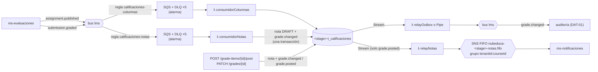
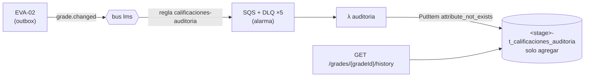

# nubeduca-ms-calificaciones

Microservicio de Nubeduca: Libro de notas, publicación ordenada de notas por SNS FIFO y auditoría inmutable de cambios.

Contrato: [`apis/ms-calificaciones.openapi.yaml`](https://github.com/nubeduca/nubeduca-contratos/blob/main/apis/ms-calificaciones.openapi.yaml) y el [catálogo de eventos](https://github.com/nubeduca/nubeduca-contratos/blob/main/eventos/catalogo.yaml) de `nubeduca-contratos`. **No se publica un evento ni se expone una ruta que no esté ahí.**

## Tareas

| Tarea | Responsable | Listo cuando |
|---|---|---|
| [EVA-02 · Calificaciones básicas](https://github.com/nubeduca/nubeduca-backlog/issues/27) | Dev 4 @Edinson695, Dev 3 @btoroled | La nota publicada llega en orden a sus consumidores (SNS FIFO, grupo `tenant_id:course_id`) |
| [DAT-01 · Auditoría de notas](https://github.com/nubeduca/nubeduca-backlog/issues/12) | Dev 5 @AIexander-lx | Cada `grade.changed` queda registrado y no se puede editar |

**Estado:** 🟢 Base armada desde `nubeduca-plantilla-servicio` y DAT-01 implementada (probada en AWS). 🟢 EVA-02 implementada: libro de notas, `grade.changed`/`grade.posted` por el outbox, `grade.posted` en orden por SNS FIFO y seed de 30.000 notas (probada con moto; falta desplegarla).

## Eventos

| | |
|---|---|
| `source` | `lms.grading` |
| Publica | `lms.grading.grade.changed.v1`, `lms.grading.grade.posted.v1` (bus y SNS FIFO `nubeduca-<stage>-notas.fifo` → ms-notificaciones) |
| Consume | `lms.assessment.assignment.published.v1`, `lms.assessment.submission.graded.v1`, `lms.courses.enrollment.created.v1`, `lms.courses.enrollment.dropped.v1` |

## Libro de notas (EVA-02)



- **Columnas.** Cada `assignment.published` crea (o actualiza, si llega una versión nueva de la tarea) una columna del libro de su curso. La columna usa el mismo ULID que la tarea (`asg_X` → `gri_X`), así una nota que llega antes que su columna ya sabe dónde va.
- **Notas en borrador.** Cada `submission.graded` guarda la nota del alumno en esa columna como `DRAFT` y publica `grade.changed` (`GRADED`) en la misma transacción. Si el alumno ya tenía nota (otra entrega o una recalificación), se actualiza, sube su versión, `previousScore` es el puntaje anterior y **vuelve a `DRAFT`** aunque ya estuviera publicada (el catálogo dice "guarda la nota en borrador"); el docente la vuelve a publicar. Si el puntaje no cambió, o la calificación es más vieja que el último cambio de la nota (por ejemplo, un ajuste manual posterior), no se hace nada.
- **Publicar.** `POST /grade-items/{gradeItemId}/post` pasa los `DRAFT` de la columna a `POSTED` y emite un `grade.posted` por alumno (de a 50 notas por transacción). Volver a llamarla publica solo lo que quedó en borrador.
- **Ajuste manual.** `PATCH /grades/{gradeId}` (`score` ≤ `maxScore` y `reason` de 5 a 500 caracteres) emite siempre `grade.changed` (`MANUAL_OVERRIDE`) y, si la nota ya estaba `POSTED`, también `grade.posted` con el valor nuevo.
- **Permisos.** `tenant_id` y rol salen solo del token. El libro, publicar y ajustar son del TEACHER matriculado como TEACHER en el curso; `grades/me` es del STUDENT matriculado y devuelve solo sus notas `POSTED`. El libro tiene una fila por alumno matriculado (`PROY#ENROLL#`).
- **Concurrencia.** Cada nota tiene `version` (la `aggregateVersion` de sus eventos) y se escribe con condición sobre la versión leída. Si otro proceso la cambió antes, no se guarda nada: la ruta vuelve a leer y reintenta, y el consumidor devuelve el mensaje a la cola. Para eso `lib/inbox.py` ahora distingue un duplicado (falla la condición del inbox o de la versión) de un conflicto en las escrituras de la reacción (`inbox.Conflicto`, se reintenta); antes los dos contaban como duplicado y el evento se perdía.

### `grade.posted` en orden por SNS FIFO

Criterio de EVA-02: **la nota publicada llega en orden a sus consumidores.**

1. La nota y su `grade.posted` se guardan en la misma transacción (outbox). Todos los `EVENTO#` de un tenant están en la misma partición, así que el Stream los entrega en el orden en que se escribieron.
2. `relayNotas` (`relay/stream_a_sns.py`) lee el Stream filtrado a `grade.posted` y los publica **uno por uno, en ese orden**, en `nubeduca-<stage>-notas.fifo` con `MessageGroupId = <tenantId>:<courseId>` y `MessageDeduplicationId = eventId`. El mensaje es el `detail` del evento (ms-notificaciones se suscribe con raw delivery).
3. Si una publicación falla, el Stream reintenta el lote completo (sin bisect y con `parallelizationFactor: 1`): nada se salta. Lo que ya se había publicado, SNS lo descarta por `eventId`.

El tópico lo crea `infra/bus` de `nubeduca-backend`; para otro nombre: `--param="notasTopic=..."`. `relayNotas` está siempre encendido (el Pipe de `outbox=pipe` solo llega al bus) y es el segundo lector del Stream, el máximo que admite DynamoDB. `grade.posted` también va al bus como cualquier evento; `grade.changed` llega a la auditoría por su regla, sin llamar a nada.

## Auditoría de notas (DAT-01)



- **Cada `lms.grading.grade.changed.v1` queda registrado.** La Lambda `auditoria` valida el evento contra su esquema y lo guarda con `PutItem` condicional (`attribute_not_exists(sk)`). Si SQS lo entrega dos veces, el segundo intento no hace nada. A diferencia de un consumidor normal, **no descarta versiones viejas**: guarda todos los cambios, lleguen en el orden que lleguen. Un evento que no cumple el contrato se reintenta y termina en la DLQ, que tiene alarma, así que no se pierde en silencio.
- **No se puede editar.** La tabla tiene una política de recurso que **niega** `UpdateItem`, `DeleteItem`, `BatchWriteItem`, `PartiQLUpdate` y `PartiQLDelete` a cualquier principal, el LabRole incluido. Probado en AWS: las cinco operaciones dan `AccessDenied`. Además el código no tiene ninguna operación de edición, la tabla no tiene TTL, tiene PITR, y en `prod` tiene protección contra borrado.
- **`GET /grades/{gradeId}/history`**: TEACHER matriculado como TEACHER en el curso de la nota, o ADMIN. Devuelve los cambios, el más antiguo primero (ordenados por `aggregateVersion`).
- **Para EVA-02:** no hay que llamar a nada. Basta con publicar `grade.changed` por el outbox; la regla `nubeduca-<stage>-calificaciones-auditoria` lo lleva a la auditoría.

Límite conocido: la política no puede impedir un `PutItem` sin condición que pise un registro (IAM no tiene una condición para eso). El código siempre usa la condición, y el `detail` original queda guardado en cada registro como evidencia.

## Estructura de las tablas

**`<stage>-t_calificaciones`** (principal; PK `tenant_id` + `sk`, Stream para el outbox). Los ítems `EVENTO#`, `INBOX#` y `AGG#` son los de la plantilla. El libro de notas de un curso (columnas y notas) sale de una sola consulta: `begins_with(sk, "COURSE#<courseId>#")`.

Columna del libro de notas (EVA-02, de `assignment.published`) · `sk = COURSE#<courseId>#ITEM#<gradeItemId>`

```json
{"tenant_id": "utec", "sk": "COURSE#crs_01JCQRZHQT9F4WY2JYPDV546K7#ITEM#gri_01JCF4SQ7XAMY8HTMRFHAWZ73F",
 "entidad": "GRADE_ITEM", "gradeItemId": "gri_01JCF4SQ7XAMY8HTMRFHAWZ73F", "courseId": "crs_01JCQRZHQT9F4WY2JYPDV546K7",
 "assignmentId": "asg_01JCF4SQ7XAMY8HTMRFHAWZ73F", "title": "Laboratorio 4: SQS y DLQ", "maxScore": 20,
 "dueAt": "2026-11-20T23:59:00Z", "createdAt": "2026-11-11T15:21:00Z", "updatedAt": "2026-11-11T15:21:00Z", "version": 2}
```

`version` es la `aggregateVersion` de la tarea.

Nota de un alumno en una columna (EVA-02) · `sk = COURSE#<courseId>#GRADE#<gradeItemId>#<studentId>`

```json
{
  "tenant_id": "utec",
  "sk": "COURSE#crs_01JCQRZHQT9F4WY2JYPDV546K7#GRADE#gri_01JCF4SQ7XAMY8HTMRFHAWZ73F#a18577e2-e005-4a49-a29e-755dbf08f5b6",
  "entidad": "GRADE",
  "gradeId": "grd_01JCHPYHNDAZZ52VG7CCWED8VE",
  "gradeItemId": "gri_01JCF4SQ7XAMY8HTMRFHAWZ73F",
  "courseId": "crs_01JCQRZHQT9F4WY2JYPDV546K7",
  "assignmentId": "asg_01JCF4SQ7XAMY8HTMRFHAWZ73F",
  "submissionId": "sbm_01JCY7SYF5X0ZHRJ7KQSVX4BP0",
  "studentId": "a18577e2-e005-4a49-a29e-755dbf08f5b6",
  "score": 17.5,
  "maxScore": 20,
  "status": "POSTED",
  "postedAt": "2026-11-15T15:25:00Z",
  "postedBy": "c62d9930-b473-4b1d-adec-72fdda7cf599",
  "cause": "MANUAL_OVERRIDE",
  "reason": "Revisión de la pregunta 3",
  "changedBy": "c62d9930-b473-4b1d-adec-72fdda7cf599",
  "changedAt": "2026-11-16T10:00:00Z",
  "createdAt": "2026-11-13T15:23:00Z",
  "version": 3
}
```

`status` es `DRAFT` o `POSTED` (`postedAt`/`postedBy` solo en `POSTED`). `cause`, `reason`, `changedBy` y `changedAt` son del último cambio de puntaje (`reason` solo en `MANUAL_OVERRIDE`). `version` sube en cada cambio y es la `aggregateVersion` de sus eventos.

Referencias por id (las rutas reciben solo el id) · `sk = REF#<gradeItemId>` y `sk = REF#<gradeId>`

```json
{"tenant_id": "utec", "sk": "REF#gri_01JCF4SQ7XAMY8HTMRFHAWZ73F", "entidad": "REF", "tipo": "GRADE_ITEM",
 "courseId": "crs_01JCQRZHQT9F4WY2JYPDV546K7", "gradeItemId": "gri_01JCF4SQ7XAMY8HTMRFHAWZ73F"}
{"tenant_id": "utec", "sk": "REF#grd_01JCHPYHNDAZZ52VG7CCWED8VE", "entidad": "REF", "tipo": "GRADE",
 "courseId": "crs_01JCQRZHQT9F4WY2JYPDV546K7", "gradeItemId": "gri_01JCF4SQ7XAMY8HTMRFHAWZ73F",
 "studentId": "a18577e2-e005-4a49-a29e-755dbf08f5b6"}
```

Evento en el outbox (de la plantilla; el Stream lo lleva al bus y, si es `grade.posted`, al tópico FIFO) · `sk = EVENTO#<eventId>`

```json
{"tenant_id": "utec", "sk": "EVENTO#01JCMK0PDR72NVMBVR2W0Z2J4Q", "entidad": "EVENTO", "source": "lms.grading",
 "detailType": "lms.grading.grade.posted.v1", "detail": "{\"metadata\":{...},\"data\":{...}}", "ttl": 1763824000}
```

Matrícula (proyección de `enrollment.created`; `enrollment.dropped` la borra) · `sk = PROY#ENROLL#<courseId>#<userId>`

```json
{"tenant_id": "utec", "sk": "PROY#ENROLL#crs_01JCQRZHQT9F4WY2JYPDV546K7#c62d9930-b473-4b1d-adec-72fdda7cf599",
 "entidad": "PROYECCION", "courseId": "crs_01JCQRZHQT9F4WY2JYPDV546K7",
 "userId": "c62d9930-b473-4b1d-adec-72fdda7cf599", "enrollmentId": "enr_01JC5F0KPBVF7HK1VV8H23JGMW", "role": "TEACHER"}
```

**`<stage>-t_calificaciones_auditoria`** (DAT-01; PK `tenant_id` + `sk`, sin Stream ni TTL) · `sk = GRADE#<gradeId>#<aggregateVersion con 10 dígitos>#<eventId>`

```json
{
  "tenant_id": "utec",
  "sk": "GRADE#grd_01JCHPYHNDAZZ52VG7CCWED8VE#0000000002#01JCSZ5F9BQKD8YNB0PX0GG63B",
  "entidad": "AUDIT",
  "gradeId": "grd_01JCHPYHNDAZZ52VG7CCWED8VE",
  "gradeItemId": "gri_01JCT5N0SZYHJTPTCBJFF2E1JD",
  "studentId": "a18577e2-e005-4a49-a29e-755dbf08f5b6",
  "courseId": "crs_01JCQRZHQT9F4WY2JYPDV546K7",
  "previousScore": 15,
  "score": 17.5,
  "maxScore": 20,
  "cause": "MANUAL_OVERRIDE",
  "reason": "Revisión de la pregunta 3",
  "changedBy": "c62d9930-b473-4b1d-adec-72fdda7cf599",
  "changedAt": "2026-11-15T10:00:00Z",
  "aggregateVersion": 2,
  "eventId": "01JCSZ5F9BQKD8YNB0PX0GG63B",
  "recordedAt": "2026-11-15T10:00:02Z",
  "detail": "{\"data\":{...},\"metadata\":{...}}"
}
```

`detail` es el evento original tal como llegó. `previousScore` es `null` en la primera calificación.

## Probar

```bash
pip install -r requirements-dev.txt
python -m pytest -q        # 63 pruebas con moto, sin AWS
```

## Seed

```bash
python scripts/poblar_datos.py --stage dev                # 30.000 notas: UTEC 15.000, UPC 10.000, PUCP 5.000
python scripts/poblar_datos.py --stage dev --escala 0.01  # 1 % para probar
```

Sin ítems `EVENTO#` (no inunda el bus ni el tópico FIFO) e idempotente (ids fijos). Calza con los seeds de ms-cursos y ms-evaluaciones: la columna `gri_<k>` es la tarea `asg_<k>` del curso `crs_<k>`, con 100 notas (los mismos 100 alumnos de seed), 60 % `POSTED` y 40 % `DRAFT`. Además de las 30.000 notas escribe lo que las rutas necesitan para leerlas: 300 columnas, sus `REF#`, los 30.000 `REF#` de nota y las matrículas de cada curso (`PROY#ENROLL#`, el docente y sus 100 alumnos), unos 91.000 ítems en total. Los usuarios demo del frontend quedan matriculados en el primer curso.

## Cómo empezar

1. Copia [`nubeduca-plantilla-servicio`](https://github.com/nubeduca/nubeduca-plantilla-servicio) a este repo (D1: un repo por microservicio). Ejemplos ya hechos: [`nubeduca-ms-usuarios`](https://github.com/nubeduca/nubeduca-ms-usuarios) y [`nubeduca-ms-cursos`](https://github.com/nubeduca/nubeduca-ms-cursos).
2. En `serverless.yml`: `service: nubeduca-ms-calificaciones`, `SERVICIO: ms-calificaciones`, `EVENT_SOURCE: lms.grading`, tabla `${sls:stage}-t_calificaciones`, y una regla, cola, DLQ y alarma para los eventos que consume. Sin línea `org:`.
3. Copia tus esquemas: `python scripts/copiar_esquemas.py --solo lms.grading`.
4. Implementa las rutas del OpenAPI con pruebas (moto, sin AWS) y CI (ruff, yamllint y pytest).
5. Agrega `scripts/poblar_datos.py --stage <stage>`: 30.000 registros en la tabla principal, **UTEC 15.000, UPC 10.000 y PUCP 5.000**, sin ítems `EVENTO#`.
6. Documenta en este README la **estructura JSON de tus tablas** (lo pide la rúbrica) y publica la URL de tu API en SSM (`/nubeduca/<stage>/api/calificaciones/url`).

## Desplegar

En la cuenta de integración (D2) se despliega con todo lo demás desde la VM `nubeduca-despliegue`: `scripts/desplegar.sh staging --con-seed` de [`nubeduca-backend`](https://github.com/nubeduca/nubeduca-backend), o solo este servicio con `--solo calificaciones`. Mientras este repo no tenga `serverless.yml`, `desplegar.sh` lo marca como **PENDIENTE**.

Reglas del equipo: Python 3.13, Serverless Framework v4, rol `LabRole`, `tenant_id` y rol solo desde el token, ramas `<tipo>/<ID>-descripcion`, commits `<ID>: mensaje` y PRs a `main` con 1 aprobación y la CI en verde.
